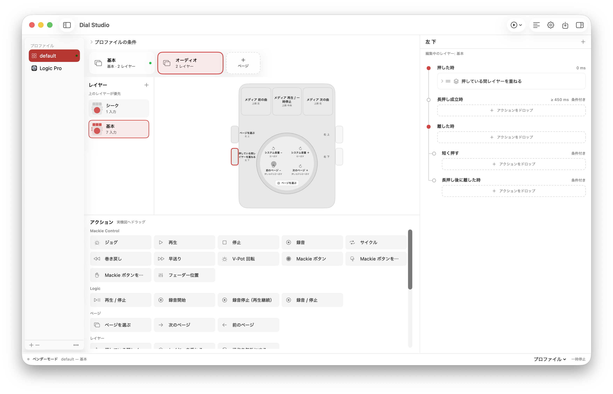

# Dial Studio

Dial Studio is an unofficial macOS app for customizing the Ulanzi D100H. Assign actions to its buttons and dial, organize them into pages and layers, and switch profiles automatically or manually.



## Why Dial Studio?

[Ulanzi Studio](https://docs.ulanzistudio.com/) provides custom controls and presets. Dial Studio focuses on flexible, app-aware workflows for macOS:

- **Stackable layers within each page**: hold or toggle layers, inherit unassigned controls, and choose which layer takes priority.
- **More ways to use each button**: assign separate actions to press, release, short press, and long-press events, or run a sequence with delays.
- **App-aware profiles**: switch automatically based on the foreground app, window title, or Chrome site, or switch manually from the device.
- **Actions beyond shortcuts**: use Mackie Control with Logic Pro and other compatible DAWs, system media controls, shell scripts, AppleScript, or JavaScript in Chrome.

## Requirements

- macOS 14 or later and a Bluetooth-paired Ulanzi D100H
- Xcode and its command-line tools to build from source
- Input Monitoring, Accessibility, or Automation permission, depending on the features used

## Build and install

```sh
./Scripts/build-app.sh
```

Copy `dist/Dial Studio.app` to Applications and open it. The build is ad-hoc signed, not notarized. The app follows the macOS app language setting and supports English and Japanese.

## Get started

1. Pair the D100H in macOS Bluetooth settings. Close other apps controlling it.
2. Open **Settings**, choose **Vendor Mode**, and click **Save and Apply**. Start the service if it is stopped and grant Input Monitoring if needed.
3. Under **Button Calibration**, select each position and press the corresponding device button. Finish calibration and apply.
4. Select a profile and page. Drag an action from the palette onto the device diagram, then edit its settings on the right. The inspector can be shown or hidden from the toolbar.
5. Click **Save** (⌘S) to apply changes to the service.

Use the toolbar's test menu to preview assignments without controlling other apps. Settings also contains the connection status, permission shortcuts, menu-bar mode, and layer-change banner options.

## Profiles, pages, and layers

A profile can match the frontmost app and, optionally, a window title or Chrome site. Add profiles from the sidebar and select the target app in **Profile Conditions**. Profile-switching actions can also select a profile manually or return to automatic switching.

Pages each contain an independent stack of layers. An unassigned control at the bottom of the stack does nothing. Select a page directly or move to the next or previous page.

Each page has its own layers. The bottom layer is always active; additional layers can be held or toggled. Create them in the column to the left of the device, then assign **Hold Layer** or **Toggle Layer** to a control. Unassigned layer controls pass through to the next active layer below. Assign **Block Input** to prevent an inherited action. Layers shown higher in the list have higher priority, with the always-active layer at the bottom. Holding a layer button activates it until that button is released.

Dial turns and press-and-turns are separate inputs. Assign each direction directly on the dial diagram. The device does not report a sustained knob press, so use a side or top button to hold a layer.

Drag controls to swap assignments, drag page cards to reorder them, and drag actions in an action sequence to change their order. Delays belong to positions in the sequence. Double-click a page name to rename it; layer names can be changed from their context menu.

Button events can run on press, hold threshold, release, short release, or release after a long hold. Place actions at each event in the inspector's timeline. Each button press retains its original event bindings across page changes. Continuous actions can start on press or at the hold threshold and end on release; if a delayed continuous action has not started by release, the sequence skips that action and continues.

## Actions

- **System**: keyboard shortcuts, scrolling, volume, mute, and media playback, track changes, and seeking. Record a shortcut by pressing it or enter a value such as `cmd+shift+p`.
- **Mackie Control**: transport, jog, V-Pots, buttons, and fader positions. In Logic Pro, add a Mackie Control surface and set its input and output to **Dial Studio MCU** while the service is running.
- **Logic**: playback and recording controls. Recording-state actions require Accessibility access and a visible Logic control bar.
- **Scripts**: shell, AppleScript, and JavaScript in the active Chrome tab. Chrome JavaScript requires **View → Developer → Allow JavaScript from Apple Events** and macOS Automation permission.
- **Plugins**: install `.dialplugin` bundles from Settings. Plugin actions appear in the action palette and can be configured and combined like other actions. The included Utilities plugin opens URLs, applications, and files.

System media seeking depends on support from the active media app and uses the private MediaRemote framework through [MediaRemote Adapter](https://github.com/ungive/mediaremote-adapter). The former YouTube-specific actions have been removed.

## Configuration and troubleshooting

Configuration is stored at `~/Library/Application Support/Dial Studio/configuration-v3.json`. Import and export are available from the sidebar menu.

If the device does not connect or an action does not run, check the connection mode, calibration, relevant macOS permissions, and the in-app log. Settings can open the relevant permission panes. A root HID helper is available for environments that require exclusive access.

## Development

```sh
swift test
swift build
```

Plugins can contain native dynamic libraries or WebAssembly modules. See [Plugin development](docs/plugins.md) for the manifest and runtime interface.

The D100H protocol implementation draws on [ulanzi-d100h-homebrew](https://github.com/brendanwelsh/ulanzi-d100h-homebrew) and [hamdial](https://github.com/ftl/hamdial).
